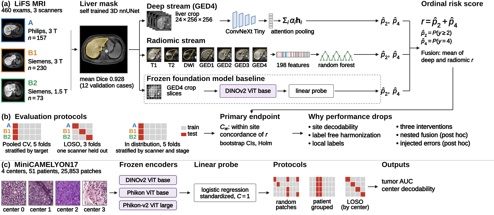

# Auditing Liver Fibrosis Staging under Scanner Shift

<p align="center">
Accepted at the Vision for Biomedical Discovery workshop (CVPath + Vision4Neuro), WACV 2027
</p>

<p align="center">
  <a href="LICENSE"></a>
  
</p>

> **Asmita Yuki Pritha**<sup>1</sup>, Xin Wang<sup>2</sup>, Shu Hu<sup>3,\*</sup>
>
> <sup>1</sup>Capstone School Dhaka, Bangladesh &nbsp; <sup>2</sup>University at Albany, SUNY, USA &nbsp; <sup>3</sup>Purdue University, USA
>
> <sup>\*</sup>Corresponding author

---

## Abstract

Pooled cross validation, in which every scanner appears in every training fold, is a common way to evaluate liver fibrosis staging models. When case mix differs between scanners, it can reward a model for recognizing the scanner rather than the liver. We audit a staging pipeline with a deep and a radiomic stream on 460 MRI examinations from three scanners, comparing protocols that differ only in which scanners contribute labeled training data; the primary endpoint, a within scanner C index, was fixed in advance. Pooled cross validation concealed an extraction error that emptied the liver crop in a quarter of the examinations. We found it by tracing why the forest's cirrhosis AUC on scanner B2 was 0.726 under pooled folds but 0.171 with B2 held out. Under leave one scanner out evaluation, where one scanner had guided earlier development, no declared alternative, including three planned interventions, beat the deep stream (C index 0.646), and the radiomic forest, which was indistinguishable from it in distribution, was significantly worse. Every representation we tested encoded the scanner, and label free harmonization neither removed this signal nor lifted the radiomic stream clearly above the deep stream. A histopathology replication with three frozen foundation models showed inflated accuracy under splits that share patients (slight for the two pathology specific encoders), near perfect hospital identification, and no transfer benefit from harmonization. Here, the choice of evaluation protocol changed which pipeline looked best.

<p align="center">
  
</p>

**Study design.** (a) Two staging streams and a frozen DINOv2 baseline, each reduced to the ordinal risk score r. (b) Evaluation protocols, primary endpoint and the analyses of why performance drops. (c) The protocol comparison repeated on histopathology. Images are real examples from LiFS and MiniCAMELYON17.

## Key results

Primary endpoint under leave one scanner out evaluation (Table 3 of the paper).

| Group | Model | C index (95% CI) | A | B1 | B2 | Δ vs. deep (95% CI) | p | Holm |
|---|---|---|---|---|---|---|---|---|
| Reference | Deep stream (GED4) | **0.646** (0.602, 0.688) | 0.578 | 0.680 | 0.683 |  |  |  |
| Family 1 | Equal fusion | 0.625 (0.583, 0.668) | 0.578 | 0.649 | 0.654 | -0.021 (-0.056, +0.018) | 0.248 | n.s. |
|  | Radiomic forest | 0.561 (0.514, 0.606) | 0.575 | 0.555 | 0.544 | -0.085 (-0.139, -0.027) | 0.003 | sig. |
|  | Frozen DINOv2 probe | 0.599 (0.551, 0.643) | **0.625** | 0.594 | 0.511 | -0.047 (-0.095, -0.000) | 0.048 | n.s. |
| Family 2 | Multiphase deep input | 0.562 (0.514, 0.609) | 0.482 | 0.616 | 0.482 | -0.084 (-0.136, -0.030) | 0.004 | sig. |
|  | Intensity augmentation | 0.609 (0.565, 0.653) | 0.567 | 0.622 | **0.704** | -0.037 (-0.073, +0.002) | 0.057 | n.s. |
|  | Adversarial scanner classifier | 0.640 (0.598, 0.684) | 0.566 | **0.691** | 0.568 | -0.006 (-0.034, +0.023) | 0.711 | n.s. |
| Post hoc | Logistic regression, ComBat | 0.643 (0.598, 0.687) | 0.676 | 0.620 | 0.679 | -0.003 (-0.063, +0.055) | 0.887 |  |
|  | Nested fusion | 0.680 (0.640, 0.720) | 0.622 | 0.712 | 0.686 | +0.034 (-0.006, +0.073) | 0.086 |  |
|  | Fusion with selected pipeline | 0.687 (0.647, 0.727) | 0.640 | 0.711 | 0.708 | +0.041 (+0.001, +0.081) | 0.046 |  |

Pooled within scanner C index of P̂(S2+) + P̂(S4) against the four level stage (95% bootstrap interval), C index per held out scanner, and difference from the deep stream. Holm decisions apply within each declared family. Post hoc rows belong to no family; the last row's pipeline was chosen with the test results in view. Bold: best declared value per column. The two significant declared comparisons both favor the deep stream.

## Repository structure

```
├── segmentation/
│   └── liver_segmentation.ipynb   # trains the nnU-Net liver segmentation model
├── notebooks/
│   ├── 1_masks_and_crops.ipynb    # liver masks and GED4 crops for the 460 examinations
│   ├── 2_radiomic_features.ipynb  # radiomic features
│   ├── 3_deep_stream.ipynb        # deep stream, leave one scanner out
│   ├── 4_liver_experiments.ipynb  # the liver experiments
│   ├── 5_histopathology.ipynb     # the replication on MiniCAMELYON17
│   └── 6_paper_numbers.ipynb      # remaining numbers, and one file with the result tables
├── assets/
│   └── overview.png               # Figure 1 of the paper
├── requirements.txt
├── CITATION.cff
├── LICENSE
└── README.md
```

## Getting started

### 0. Get the code

```bash
git clone https://github.com/Purdue-M2/auditing-liver-fibrosis-staging.git
```

Then open the notebooks in Google Colab (File > Upload notebook, or File > Open notebook > GitHub).

### 1. Environment

Everything runs on Google Colab. We used a GPU runtime with an NVIDIA A100-SXM4-40GB. The segmentation notebook needs a GPU with about 24 GB of memory (the nnU-Net ResEnc-L preset), so Colab's default T4 is not enough. The notebooks install the packages Colab lacks; `requirements.txt` lists all of them. Notebook 1 installs `numpy<2.1` for nnU-Net. We did not record exact package versions; the notebooks ran on Colab between April and November 2026.

### 2. Data and pretrained models

- **LiFS** ([Liu et al., 2026](https://arxiv.org/abs/2605.25595)), the CARE liver challenge data: 460 training examinations from three scanners (A, B1, B2), each with up to seven MRI series and a fibrosis stage from S1 to S4. It is available from the [CARE challenge site](https://zmic.org.cn/care_challenges/). We used the training archive `Liver-Train.zip` with `info_2026.csv`. The archive also holds the 30 manual liver masks (`mask_GED4.nii.gz`) that the segmentation notebook trains and validates on.
- **MiniCAMELYON17** ([`chehablab/MiniCAMELYON17`](https://huggingface.co/datasets/chehablab/MiniCAMELYON17), CC0): downloaded by notebook 5. Its dataset card asks users to acknowledge Chehab Lab and cite the CAMELYON publications listed there.
- **Pretrained weights**, downloaded by the notebooks: ConvNeXt Tiny through [`timm`](https://github.com/huggingface/pytorch-image-models), [DINOv2](https://github.com/facebookresearch/dinov2) ViT-B/14, [Phikon](https://huggingface.co/owkin/phikon) and [Phikon-v2](https://huggingface.co/owkin/phikon-v2). Phikon and Phikon-v2 are under the Owkin non-commercial license. The other weights keep their own licenses.

This repository does not include data, masks, features or trained models. The overview figure shows a few example images from LiFS and MiniCAMELYON17, as in the paper.

### 3. Google Drive

Put `Liver-Train.zip` in `MyDrive`. The notebooks write everything to `MyDrive/CARE2026_ckpts`. To use another folder, replace every `CARE2026_ckpts` in the notebooks.

### 4. Run

Run the notebooks in this order. In notebooks 1 to 6, every step starts with a short note on what it does. In the segmentation notebook, a note marks each main step.

| Order | Notebook | What it does | Hardware |
|:---:|---|---|---|
| 0 | `segmentation/liver_segmentation.ipynb` | trains the liver segmentation model | GPU with about 24 GB; in our run on an A100, about 7.3 hours per Stage 1 seed, 6.6 hours for the pseudo-labels and 12 hours for Stage 3 |
| 1 | `notebooks/1_masks_and_crops.ipynb` | liver masks and GED4 crops for all 460 examinations | GPU |
| 2 | `notebooks/2_radiomic_features.ipynb` | radiomic features | CPU |
| 3 | `notebooks/3_deep_stream.ipynb` | deep stream, leave one scanner out | GPU |
| 4 | `notebooks/4_liver_experiments.ipynb` | the liver experiments | CPU; GPU for CELLs J, P, T, R2 and 9 (Step 23), with T and R2 in the same session |
| 5 | `notebooks/5_histopathology.ipynb` | the histopathology replication | GPU for CELLs X1, 12, 13, 17 and 18 |
| 6 | `notebooks/6_paper_numbers.ipynb` | remaining numbers, and one file with the result tables | CPU |

The notebooks hold the code that produced the paper. It is not refactored. We ran it over many Colab sessions, some in parallel, and never ran these assembled notebooks from start to end. Notebooks 1 to 6 put the cells we used in an order that works. We left out cells that only checked, diagnosed or reconnected, the cells for the CARE challenge submission, experiments that are not in this paper, and repeated copies of cells. The changes from what we ran:

- Notebooks 1, 2 and 3 start with a settings cell that mounts Google Drive and sets the project folder; in notebook 2 it also installs SimpleITK and extracts `Liver-Train.zip`. In our sessions earlier cells had done this.
- CELL R2 runs the three interventions one after another. We ran multiphase in one Colab session and the other two together in a second.
- The segmentation notebook has two added cells. They write `bootstrap.py` and `best_seed.json`, which were already on our Drive; its first cell explains both.
- Six print or comment lines in the segmentation notebook, and one message each in CELLs T and 12, were reworded. No code logic changed.

Notebook 1 keeps the crop code with the extraction error described in Sec. 4.2 of the paper, because Table 2 shows its effect. Notebook 2 builds the corrected features.

## Where each result comes from

All result tables are saved in `MyDrive/CARE2026_ckpts/paper_results`. Cells are named as in the notebooks: C means CELL C, 19 means CELL 19, and Step 12 means the step with that number. In notebook 4, the code titles of some lettered cells also carry an old number, so CELLs 9, 10 and 11 appear twice there; the table gives the step number for those.

| Paper | Notebook | Cells | Saved as |
|---|---|---|---|
| Table 2: pooled vs. held out on B2 | 4 | C | `C_leaky_vs_clean.csv` |
| Table 3: primary endpoint | 4, 6 | P, U, V, R2, S2, W, 10 (Step 25); intervals for the interventions in 19 | `V_concordance.csv`, `V_primary.csv`, `S2_interventions.csv`, `W_nested_fusion_test.csv`, `C3_per_center.csv`, `C3_all_vs_deep.csv`, `C1_intervention_C_ci.csv` |
| Table 4: histopathology | 5 | X1, 12, 13, 14, 16 | `X_pathology_summary_3fm.csv`, `X_pathology_decodability_3fm.csv`, `X_pathology_nn.csv`, `X_pathology_tumour_direction_ci.csv` |
| Sec. 4.2: the 115 empty crops | 1 | Step 11 | printed list of the 115 examinations; the scanner and stage are part of each name |
| Sec. 4.2: change of the 345 unaffected examinations after the fix (relative change 0.0008, 95th percentile 0.116; median rank correlation 0.98) | 2 | Step 6, Step 7 | printed |
| Sec. S1: fusion weight and seeds | 3, 4 | Q, S2; single seed AUCs on B2 printed by Step 3 of notebook 3 | `Q_fusion_sensitivity.csv`, `S2_interventions.csv` |
| Table S1: AUC per scanner and task | 4 | B, S2 | `B_loco_summary.csv`, `S2_interventions.csv` |
| Table S2: learners and harmonization | 4 | E, U | `E_baselines.csv`, `U_combat.csv` |
| Sec. S4: additional series | 4 | F, Step 12 | `F_feature_ablations.csv`, `CTRL_feature_sets.csv` |
| Sec. S5: local labels, thresholds, four classes | 4 | G, H, O | `G_label_budget.csv`, `H_accuracy_calibration.csv`, `H_deep_4class.csv`, `O_four_class.csv` |
| Tables S3 to S5: matched seeds in distribution | 4, 6 | J, K, 9 (Step 23), 11 (Step 24), 19 | `K_in_distribution.csv`, `C2_values.csv`, `C2_comparisons.csv`, `C2_auc_id_vs_loso.csv` |
| Tables S6 to S8, Fig. S1: without B2, per scanner, scanner decodability | 4 | D, 10 (Step 25) | `D_vendor_predictability.csv`, `C3_A_B1_only.csv`, `C3_per_center.csv`, `C3_decodability_vs_transfer.csv` |
| Table S9, Fig. S2: corruption simulation | 4 | 15 | `C5_corruption_summary.csv` |
| Table S10: MiniCAMELYON17 | 5 | X1, 12 | `X_camelyon_meta.csv`, `X_camelyon_per_centre.csv` |
| Tables S11 to S15: histopathology details | 5 | 13, 14, 16, 18 | `X_pathology_*.csv` |
| Sec. 3.1: segmentation Dice of 0.928 | segmentation | Cell 12c v3 | nnU-Net log of the ST2 run |

## Citation

If you use this code, please cite:

```bibtex
@inproceedings{pritha2027auditing,
  author    = {Pritha, Asmita Yuki and Wang, Xin and Hu, Shu},
  title     = {Auditing Liver Fibrosis Staging under Scanner Shift},
  booktitle = {Proceedings of the IEEE/CVF Winter Conference on Applications of Computer Vision (WACV) Workshops},
  year      = {2027}
}
```

## Acknowledgments

Shu Hu is supported by the U.S. National Science Foundation (NSF) under grants IIS-2434967. The views, opinions, and/or findings expressed are those of the author and should not be interpreted as representing the official views of NSF.

The liver masks come from [nnU-Net](https://github.com/MIC-DKFZ/nnUNet). The radiomic features follow the shape, texture, appearance and direction features of Zhou et al. for CARE 2025 ([code](https://github.com/YangForever/care2025_liver_biodreamer)). The LiFS data come from the CARE liver challenge ([Liu et al., 2026](https://arxiv.org/abs/2605.25595)). MiniCAMELYON17 is from Chehab Lab and is built on the CAMELYON data (Litjens et al., 2018; Bándi et al., 2019; Ehteshami Bejnordi et al., 2017).

## License

The code and documentation in this repository are released under the [MIT License](LICENSE). The license does not cover the data, the pretrained models or the example images in the overview figure, which keep their own licenses and terms.

## Contact

Asmita Yuki Pritha (asmitayukipritha@gmail.com), or open an issue.
